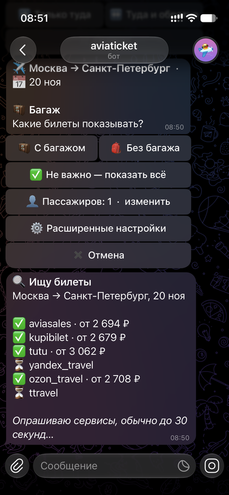
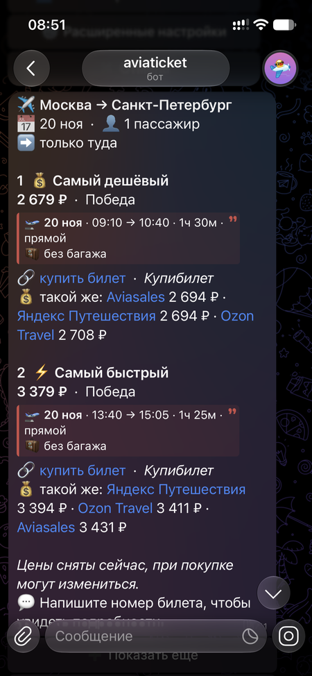
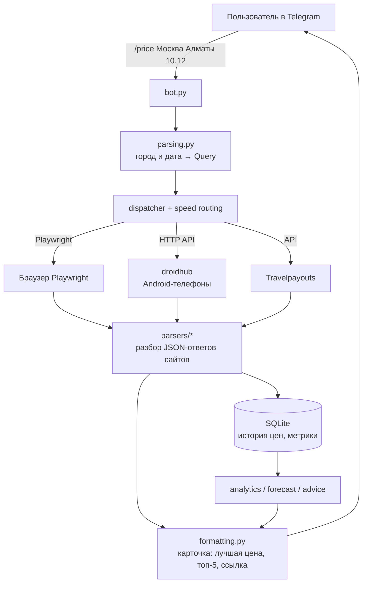

# ✈️ avia-bot: поиск дешёвых авиабилетов в Telegram


Пишете боту `/price Москва Алматы 10.12`, и он присылает лучшие цены сразу с шести сайтов: **Aviasales, Яндекс Путешествия, Туту, Купибилет, OZON Travel и Т-Путешествия**. Можно подписаться на маршрут, и бот сам напишет, когда билет подешевеет, а ещё подскажет, брать сейчас или подождать.

LLM в основном пути нет: цены разбираются обычными парсерами, поэтому бот работает быстро, дёшево и предсказуемо.

<p align="center">
  
  &nbsp;&nbsp;
  
</p>
<p align="center"><sub>Слева: бот опрашивает сайты, цены появляются по мере ответа. Справа: итоговая карточка со ссылкой на покупку и сравнением цены того же билета на других сайтах.</sub></p>

## Возможности

- **Живой поиск по 6 сайтам.** Браузер открывает выдачу, сайт сам запрашивает цены JSON-ответами, а бот забирает именно их. Это надёжнее, чем разбирать HTML-вёрстку.
- **Подписки на маршруты.** Бот проверяет цены по расписанию и пишет, когда цена ниже обычной для этого маршрута.
- **История и аналитика.** Цена каждого найденного билета сохраняется в SQLite. Бот рисует график (matplotlib), показывает тренд за 3 и 7 дней и подсказывает, на каком сайте этот маршрут обычно дешевле.
- **Совет «брать или ждать».** Правила, тренды и кривая цен до вылета, плюс модель, которая оценивает, упадёт ли цена на 5% и больше.
- **Сбор через реальные Android-телефоны.** Через [droidhub](https://github.com/pazrabi/droidhub) страницы открываются в мобильном Chrome с домашним IP. Телефон для каждого сайта выбирается по замерам скорости и надёжности. Ненадёжные пары «сайт × телефон» уходят в карантин, а телефоны с низким зарядом не используются.
- **Надёжность.** Лимиты и повторные попытки, кеш свежих результатов, «хеджирование» медленных запросов, мониторинг парсеров с оповещениями админам и ежедневные бэкапы баз.
- **Админ-панель в Telegram.** Статистика, управление пользователями и телефонами, проверка нового телефона по кнопке.

## Как устроено



## Стек

Python 3.12 · asyncio · httpx (Telegram Bot API напрямую, без фреймворков) · Playwright · SQLite · matplotlib · pytest + pytest-asyncio · systemd на VPS

## Что интересного внутри

| Модуль | Что делает |
|---|---|
| `src/avia/parsers/` | Парсер под каждый сайт, написан по реальным ответам. Тесты гоняются на сохранённых фикстурах |
| `src/avia/recon.py` | «Разведка» нового сайта: сохраняет все JSON-ответы страницы и сортирует их по похожести на цены |
| `src/avia/speed.py`, `dispatcher.py` | Маршрутизация запросов по телефонам по медианам скорости и доле успехов |
| `src/avia/hedge.py`, `stop_rule.py` | Ускорение живого поиска: дублирование медленных запросов и остановка, когда минимум цены стабилизировался |
| `src/avia/forecast.py`, `advice.py` | Прогноз и совет «брать или ждать» |
| `src/avia/parser_watch.py`, `samples.py` | Проверка парсеров на живых образцах и алерты, когда сайт поменял формат |

---

# Техническая документация


Цена авиабилета «здесь и сейчас» в Telegram, без LLM: обычные скрипты.

```
/price Москва Алматы 10.12
   │
   ▼
parsing.py     город/дата → Query(MOW, ALA, 2026-12-10)
   │
   ▼
pipeline.py    для каждого сайта из config/sites.yaml:
   ├─ source: api      → parsers/travelpayouts.py   (HTTP-запрос, без браузера)
   └─ source: browser  → collector.py (Playwright) → парсер из parsers/ по реальному JSON сайта
   │
   ▼
formatting.py  Telegram (HTML): лучшая цена, топ-5 по каждому сайту, ссылка
```

## Что работает сразу

**aviasales_cache** (Travelpayouts Data API): нужен только бесплатный токен из кабинета Travelpayouts (раздел API). Это кэш поисков Aviasales за последние ~48 часов, а не живая цена, поэтому в сообщении всегда есть ссылка на живую выдачу. Цена в API за одного пассажира, бот умножает на число пассажиров.

## Живые цены с сайтов (браузер + парсер)

Playwright открывает выдачу, сайт сам запрашивает цены JSON-ответами, и бот забирает именно их. Это надёжнее разбора вёрстки, но формат ответа у каждого сайта свой, поэтому парсеры пишутся по реальным данным. Порядок для нового сайта:

1. Снять шаблон URL выдачи руками и вписать в `config/sites.yaml` (у Aviasales уже есть).
2. Разведка: `python -m avia.recon aviasales Москва Алматы 10.12 --show`. В `debug/recon/aviasales/` появятся все JSON-ответы страницы, `index.txt` со списком (самые похожие на цены сверху), `page.txt` и скриншот.
3. Прислать мне эту папку, я пишу парсер в `src/avia/parsers/` (`@register_parser("aviasales")`) и тест на ваших данных.
4. В `sites.yaml` поставить `parser: aviasales`, `enabled: true`.

Если сайт покажет капчу, пройдите её руками при запуске с `--show`: сессия сохранится в `state/`.

## Установка и запуск

```bash
cd avia-bot
python -m venv .venv && source .venv/bin/activate
pip install -r requirements.txt
playwright install chromium
cp .env.example .env     # TG_BOT_TOKEN, TG_ALLOWED_IDS, TP_TOKEN, TP_MARKER

python -m avia.cli Москва Алматы 10.12   # без Telegram
python -m avia.bot                       # Telegram-бот
pytest                                   # тесты
```

## Необязательно: LLM как запасной разбор

Для сайта, у которого парсера нет или он ничего не нашёл, в `sites.yaml` можно поставить `use_llm: true`: страница уйдёт в LLM. По умолчанию выключено. Бэкенды (`LLM_BACKEND` в `.env`):

- `gemini_local`: установленный на Маке `gemini` CLI.
- `agy_ssh`: аккаунт acc4 из пула на VPS. Вход Google лежит на сервере, поэтому текст страницы отправляется туда по SSH, где обёртка `deploy/avia-llm` запускает `agy` под профилем acc4 и его исходящим каналом. Обёртку нужно один раз положить на сервер (`scp` в `/opt/gemini-pool/bin/avia-llm`, `chmod 755`), acc4 на это время поставить на паузу в панели пула, затем проверить `python -m avia.smoke`. Обёртка запускает `agy` без `--dangerously-skip-permissions`: текст чужих сайтов недоверенный, а у пользователя `pool` есть доступ к токенам пула. Smoke-тест проверяет это «канарейкой».

## Выбор телефона по скорости

Телефоны droidhub выбираются автоматически по реальным замерам скорости пары «сайт × телефон»:
- **Живой поиск людей (priority 0):** быстрые телефоны идут первыми. Если телефон медленнее лучшего больше чем в `speed_slow_ratio` раз (по умолчанию 3.0), он становится запасным с терпением от разницы медиан.
- **Подписки и фон (priority > 0):** медленные телефоны берутся первыми, быстрые — только если медленные заняты дольше `speed_bg_patience_seconds` (по умолчанию 60 с). Новые пары без замеров (`n == 0`) исследуются фоновыми задачами первыми.
- **Самоисцеление и карантин:** 3 неудачи подряд (502, капча, неполная выдача без офферов) отправляют пару в карантин на 10 минут (`speed_quarantine_seconds`). После выхода из карантина пара получает одну пробную попытку исключительно от фоновой задачи.
- **Ненадёжные пары:** пары с долей успешных запусков `ok_rate < 0.4` при `n >= min_samples` автоматически выпадают из основного порядка.
- **Защита батареи:** телефоны с зарядом ниже `phone_min_battery` (по умолчанию 15%) и не на зарядке не берутся в работу.
- **Откат:** переменная `SPEED_ROUTING=0` отключает динамическую маршрутизацию и возвращает прежний порядок.

## Что стоит знать

- **Условия сайтов.** Автоматический сбор выдачи может нарушать их пользовательские соглашения, а антибот-защита может блокировать. Для личного мониторинга небольшими объёмами это рабочий вариант. Travelpayouts Data API это официальный путь.
- **Парсеры ломаются при смене сайта.** Это цена отказа от LLM: если выдача перестала разбираться, бот пишет «0 вариантов» или ошибку по этому сайту, остальные источники продолжают работать. Тогда снова `recon` и правка парсера.
- **Безопасность.** Бот отвечает только id из `TG_ALLOWED_IDS`.

## Подключение нового телефона: проверка по кнопке

Новые телефоны, обнаруженные в хабе droidhub при политике `PHONES_NEW_POLICY=check` (значение по умолчанию), получают статус `new` (ожидает проверки) и не допускаются к поиску (ни для пользователей, ни для фона и подписок).

1. **Оповещение:** при первом обнаружении нового телефона администраторам бота отправляется сообщение с кнопкой «🔍 Проверить <имя>».
2. **Запуск проверки:** только администраторы могут запустить проверку — по кнопке в `/admin` → **📱 Телефоны** или командой `/phone <id> test`.
3. **Что делает проверка:**
   - Последовательно для каждого сайта с телефоном запускает 5 проходов (для сайтов с полным режимом ещё 5 в фоновом режиме) на контрольном маршруте MOW→LED (~35 дней от текущей даты).
   - Фиксирует: доступность страницы, капчу, число офферов, полноту выдачи (`results_complete`), минимальную цену и время ответа.
   - Сверяет минимальную цену с эталоном (медианой цен за 24 ч у других устройств) — допустимо расхождение не более 15% (при отсутствии эталона сверка пропускается).
   - Записывает замеры в метрики `site_runs` для наполнения таблицы скоростей.
   - При недоступности устройства (все проходы 502) проверка завершается досрочно («не отвечает, проверьте экран и питание»).
4. **Допуск:**
   - Если хотя бы один сайт получил вердикт «ок», телефон переводится в статус `active`, а в `sites_allow` включаются успешно прошедшие сайты.
   - Если ни один сайт не прошёл проверку, телефон остаётся в статусе `new` с сохранением причины в реестре.
   - Перепроверка активного телефона обновляет его `sites_allow`, не выключая телефон при сбоях. Перепроверка телефона на `hold` оставляет статус `hold`.

